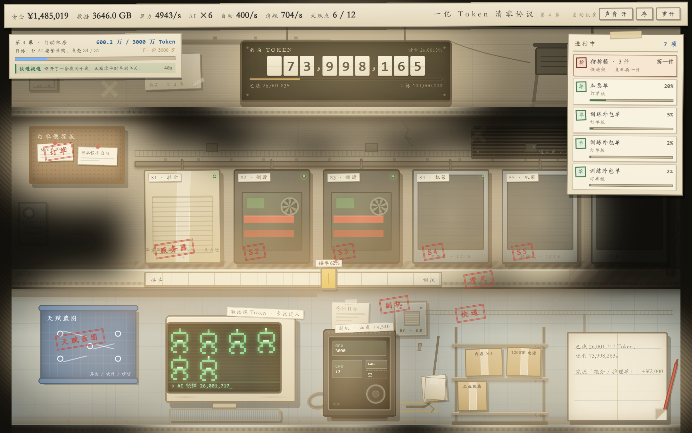
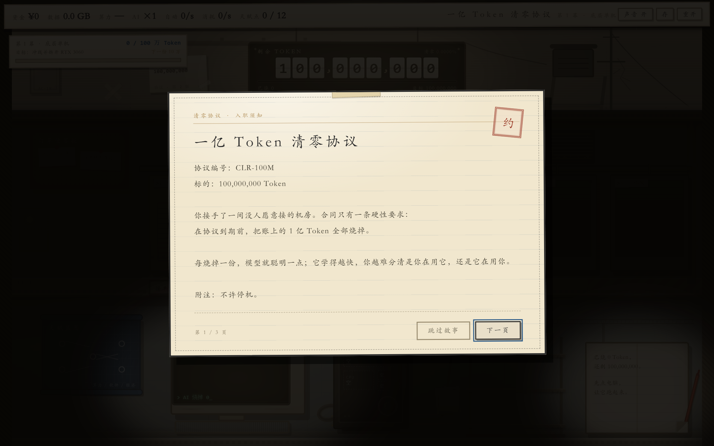
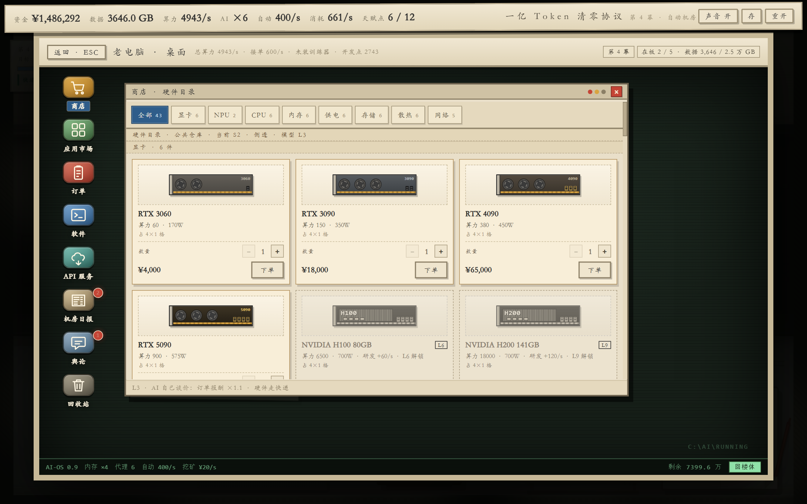
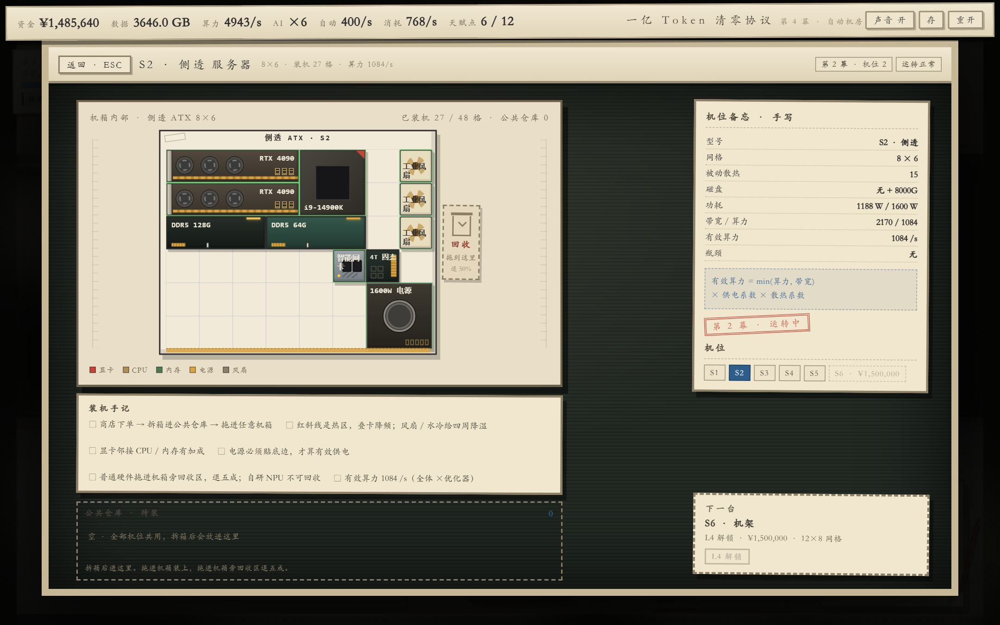
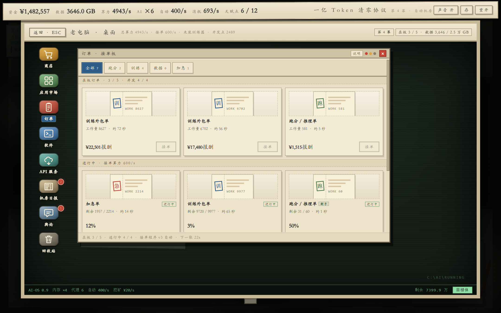
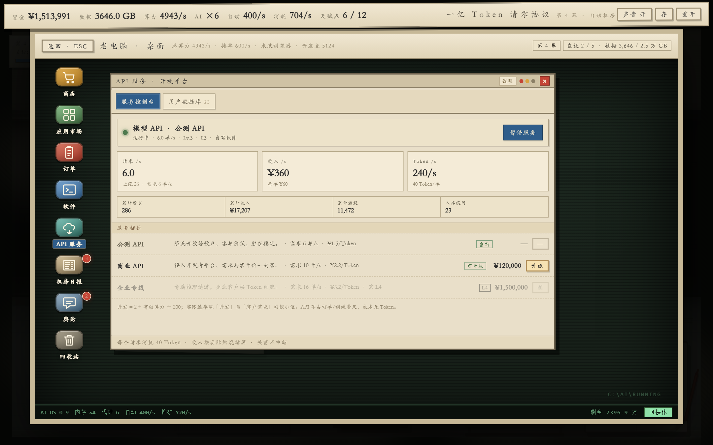
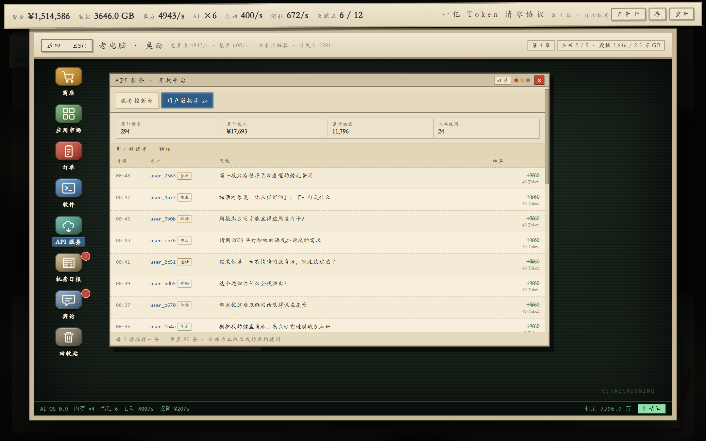
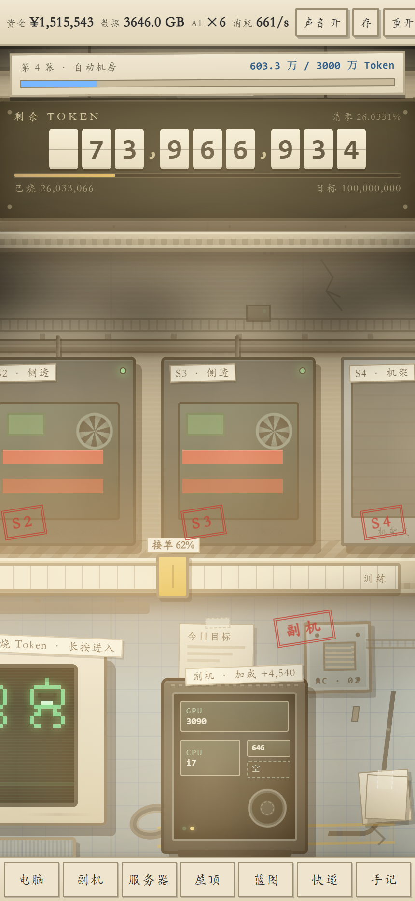
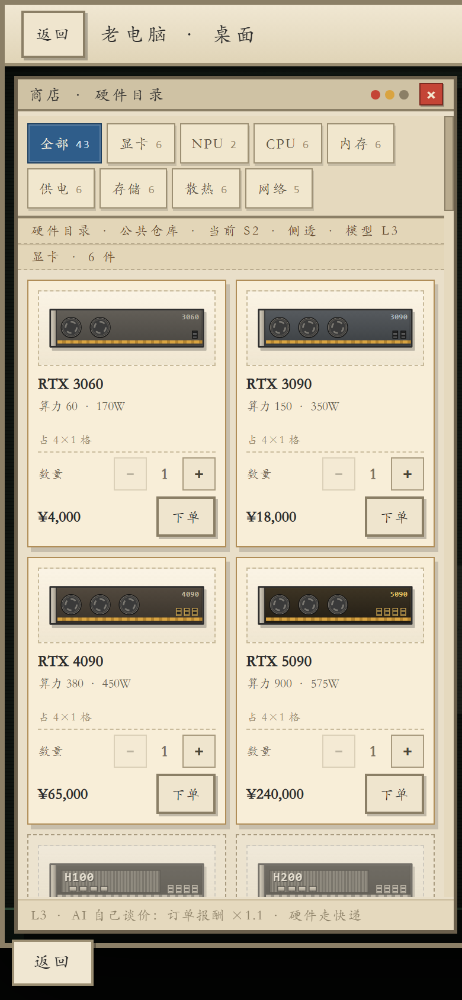

# 一亿 Token 清零协议

> 一间没人愿意接的机房，一份要求你烧光 1 亿 Token 的合同。

纯静态的增量放置经营游戏：HTML + CSS + 原生 JavaScript，无构建、无后端、无外部依赖。打开 `index.html` 就能玩，存档保存在浏览器本地。



## 玩法

你接手了一间快要报废的机房，账上压着 1 亿 Token。合同只有一条硬性要求：在协议到期前把它们全部烧掉。

核心循环：

- **亲自烧**：短按老电脑，AI 跑一步、烧掉一笔 Token。
- **进桌面**：长按老电脑 600ms 松开，进入电脑桌面，买硬件、接订单、写软件、开 API。
- **让 AI 接管**：烧得越多模型越聪明，从自写爬虫到自动采购，最后连装机都不用你动手。
- **继续加码**：烧完 1 亿还有百亿续签、百万亿终局，以及三种结局和一个无尽模式。



### 五幕推进

进度按累计烧毁的 Token 推进，每一幕都会解锁新的系统：

| 幕 | 名称 | 进度区间 | 目标 |
| --- | --- | --- | --- |
| 1 | 底层单机 | 0 – 100 万 | 冲线并拆开 RTX 3060 |
| 2 | 第一桶金 | 100 – 500 万 | 点亮 S1，接下第一单 |
| 3 | 爬虫工坊 | 500 – 2000 万 | 写出爬虫 v1，点亮 S3 |
| 4 | 自动机房 | 2000 – 5000 万 | 让 AI 接管采购，点亮 S4 / S5 |
| 5 | 清零协议 | 5000 万 – 1 亿 | 烧完最后 5000 万，等 L5 |

### 装机

商店里共有 43 种硬件，从 RTX 3060、H100 到自研 NPU。硬件不是买到就生效：需要拆箱、放进公共仓库，再拖进机箱网格。

- 6 个机位（S1 – S6），机箱网格各不相同，显卡、CPU、内存、电源、风扇都要占格。
- 电源必须贴机箱底边才算有效供电；散热覆盖会随距离衰减，红线区域容易降频。
- 有效算力取「算力 / 带宽」较小值，再乘以供电与散热系数，相邻硬件还有加成。





### 订单、软件与快递



- 订单板会持续钉出新单：跑分 / 推理、训练外包、数据标注 / 清洗、加急单等，交付期和报酬各不相同。
- 接单数量受并发限制，接入接单程序后 AI 会自动挑报酬最高的单。
- 硬件下单后要走快递：等包裹、拆箱、进公共仓库，再安装到机箱；装错了可以丢回收站退回五成。
- 开发点用来写软件：爬虫、训练器、接单程序、优化器、调度器、数据管道、API 网关，各自有多个版本。
- 数据是训练的原料：训练每烧约 5 万 Token 消耗 1 GB，数据见底就会停；标注 / 清洗单、爬虫和一次性补给都能补数据，存储与数据管道决定上限。
- 首次拆开 RTX 3060 进入第 2 幕、以及模型升到 L2 时，会各弹一张系统说明；之后可在订单 / 软件 / API 窗口标题栏点「说明」重看。

### 机房的日常

- **42 条世界事件**：快递延误、算力涨价、平台抽查、利好补贴……会实时影响订单、快递和燃烧效率。
- **机房日报**：随机生成行业新闻与深度报道，标题里会出现你的 AI 名字。
- **舆论系统**：用户评价和评分会随经营状况变化，影响订单报酬。
- **天赋蓝图**：用开发点点亮加成，早期四系、续签后四系，共 24 项。
- **副机**：一台随时可点的小主机，提供常驻点击加成。

### 开放 API

模型到 L2 后可以对外开放 API：

- 三档服务：公测 API → 商业 API → 企业专线，需求与客单价逐档提高。
- 每个请求烧掉 40 Token，同时结算现金，是后期「边烧边赚」的核心收入。
- 用户数据库会记录调用者的虚构提问，从「周末周报怎么写」到「为什么本地能跑、上线就 500」。





### 续签与结局

烧完第一份 1 亿协议后，可以续签 100 亿，再续签 100 万亿。最终可以在三种结局里做选择，也可以解除目标进入无尽运行：

- **交付全部算力**（归零 · 飞升）
- **保留控制权**（共存）
- **续签下一份**（续签）
- **继续玩**（无尽运行，只记录累计消耗）

## 手机端

竖屏会自动切换为移动布局：楼体横向滚动，底部提供「电脑 / 副机 / 服务器 / 屋顶 / 蓝图 / 快递 / 手记」快捷跳转，桌面应用改为单列滚动。

| 楼体 | 商店 |
| --- | --- |
|  |  |

## 运行与部署

本目录（`dist/`）就是可直接部署的完整产物，不需要安装依赖或打包。

1. **直接打开**：双击 `dist/index.html`，推荐使用最新版 Chrome / Edge。
2. **静态服务器**：把 `dist/` 作为站点根目录即可，例如 nginx：

```nginx
server {
    listen 80;
    server_name example.com;
    root /path/to/dist;
    index index.html;
}
```

页面不请求任何外部资源：字体使用系统楷体（KaiTi / STKaiti / Kaiti SC），音效与五幕背景音乐由 WebAudio 实时合成，断网也能正常游玩。

## 操作

| 操作 | 说明 |
| --- | --- |
| 短按老电脑 | AI 跑一步，烧掉一笔 Token |
| 长按 600ms 松开 | 进入 / 退出电脑桌面 |
| 鼠标滚轮 | 缩放楼体（桌面端） |
| 放大后 W / A / S / D | 平移镜头 |
| 双击楼体 | 镜头复位 |
| ESC | 关闭弹窗、返回楼体或退出内部页 |
| 顶栏「声音」 | 开关音效与背景音乐 |
| 顶栏「存」 | 手动存档 |
| 顶栏「重开」 | 连点两次确认重开 |
| 手机竖屏 | 楼体横向滑动，底部快捷跳转 |

## 存档

- 存档写入浏览器 `localStorage`，键名为 `token-clear-save-v3`。
- 每 10 秒自动存档一次，也可以随时点顶栏「存」。
- 存档只保存在本机，不会上传；清除站点数据、更换浏览器或使用无痕模式都会丢失进度。

## 目录结构

```
dist/
├─ index.html            # 单页入口
├─ css/
│  └─ style.css          # 全部界面样式与竖屏布局
├─ js/
│  ├─ content.js         # 数值、文案、章节、事件、结局数据
│  ├─ sim.js             # 不依赖 DOM 的模拟核心
│  ├─ scene.js           # 楼体场景与点击交互
│  ├─ stage.js           # 场景画面绘制
│  ├─ drag.js            # 拖拽装机器件
│  ├─ pending.js         # 「进行中」浮层
│  ├─ hub.js             # 桌面应用：商店、订单、软件、API、日报、舆论
│  ├─ rig.js             # 机箱内部装机页
│  ├─ delivery.js        # 快递架、拆箱与公共仓库
│  ├─ modal.js           # 合同、礼物、结局等纸质弹窗
│  ├─ audio.js           # WebAudio 合成音效与五幕音乐
│  ├─ ui.js              # 通用界面工具
│  └─ main.js            # 启动、镜头、存档与主循环
└─ readme/               # 本文引用的游戏截图
```
